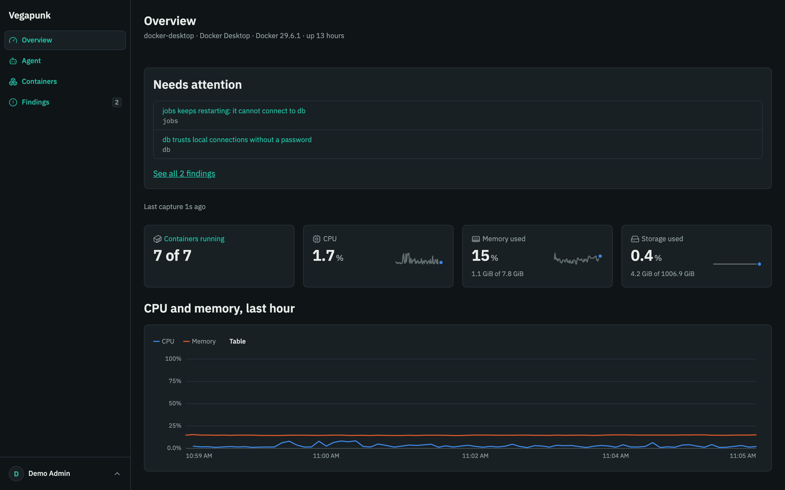
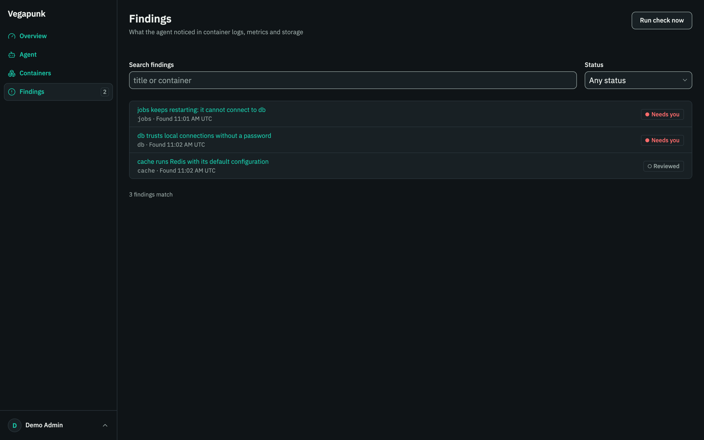
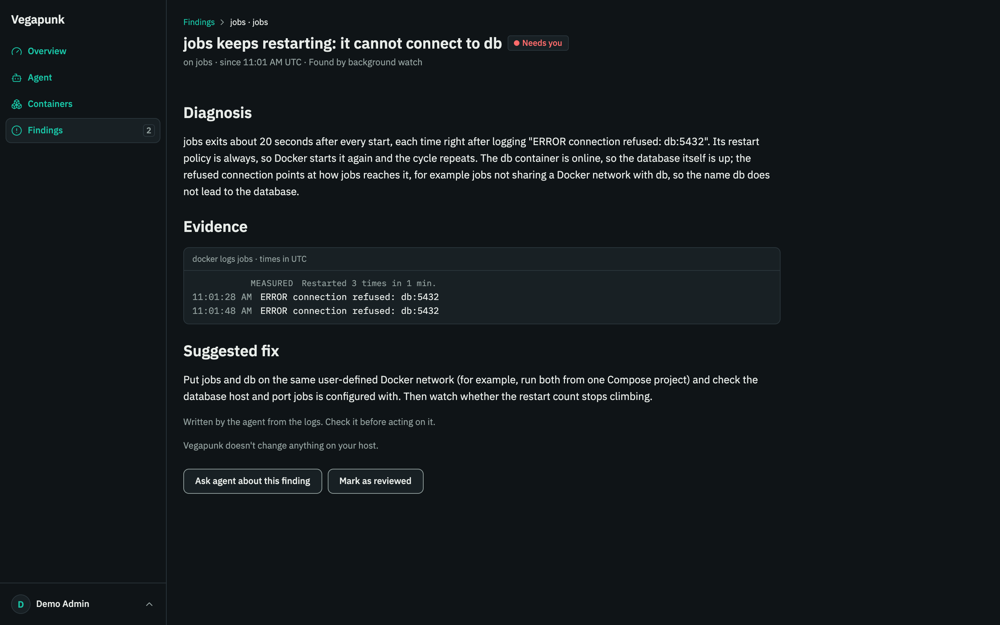
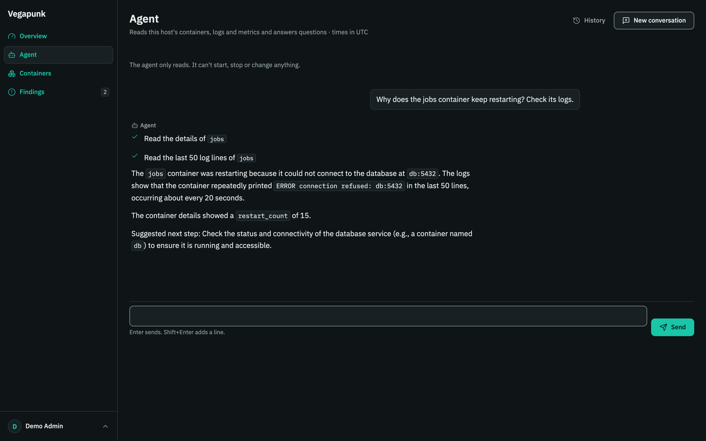
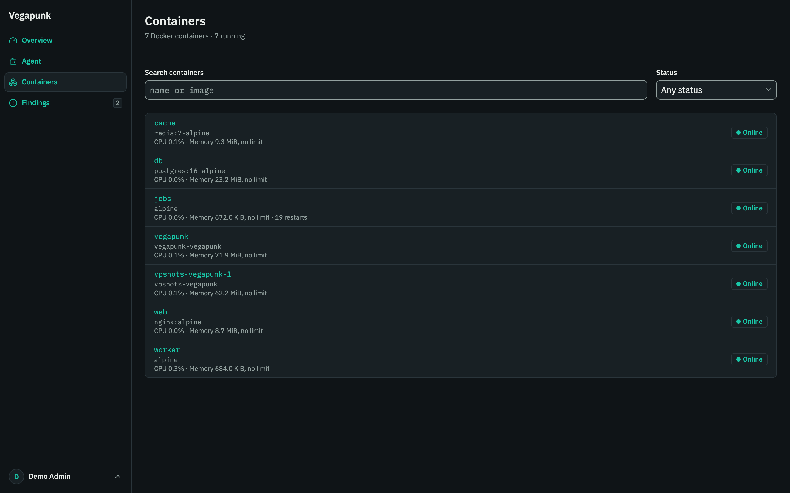

# Vegapunk

[](https://github.com/xdadwal/vegapunk/actions/workflows/ci.yml?query=branch%3Amain)
[](LICENSE)
[](https://github.com/xdadwal/vegapunk/releases)

An open-source tool for managing a homelab host and its services.

> **Status:** Pre-release, version 0.1.0. It watches and reports; it does not change anything on your host yet. Expect things to change.

## Overview

Vegapunk is a single server that runs on your homelab host. It periodically captures data about the host and the containers running on it, and gives you a web interface to view them.

**What it is:**

- A web interface for one host: its CPU, memory and storage, and each container's status, restarts, CPU and memory, with history for trends.
- An agent that watches that data, raises findings (a diagnosis with the evidence behind it and a suggested fix in words), and answers your questions in a chat. It uses an AI provider you choose.
- One container on the host it watches, with the host's Docker socket mounted. There is no separate agent to install.

**What it isn't (yet):**

- It doesn't change anything. Vegapunk only reads and reports: it can't start, stop or restart containers, and the agent can't run commands. Managing containers is planned for later.
- It watches one host, the one it runs on. Multiple hosts are out of scope.
- It manages Docker containers only, with one admin account and no other users.

## Screenshots



| | |
|---|---|
|  |  |
| **Findings** the agent raised, by status. | **A finding**: diagnosis, evidence and a suggested fix in words. |
|  |  |
| **The agent** answering a question from the container's logs. | **Containers** with their status, usage and restarts. |

Screenshots are from a demo instance with sample containers; the agent answer is a real answer from a local model (Gemma), and the findings are sample data.

## Quick start

You need Docker with Compose.

```sh
git clone https://github.com/xdadwal/vegapunk.git
cd vegapunk
docker compose up -d --build
```

On Linux, start it this way instead, so it can read the Docker socket:

```sh
DOCKER_GID=$(stat -c %g /var/run/docker.sock) docker compose up -d --build
```

Then open http://localhost:8000 and create the admin account. If port 8000 is taken, set `VEGAPUNK_PORT` (for example `VEGAPUNK_PORT=8080`).

- [Install guide](docs/install.md): configuration, backups, upgrading, uninstalling and troubleshooting.
- [Read-only Docker socket proxy](docs/socket-proxy.md) (optional).
- [Security](SECURITY.md): what Vegapunk protects and how to report a problem.

## The agent

Vegapunk has an agent you can ask about your host: "Is anything wrong right now?", "Why is a container restarting?". It answers by reading what Vegapunk has captured, plus a container's live logs. **It only reads. It can't start, stop or change anything.**

It runs on your own AI provider. After you create the admin account, Vegapunk asks for one; you can skip that and add it later in Settings.

- **Which provider.** Any server that speaks the OpenAI API: OpenAI itself, OpenRouter, or a local server such as Ollama or vLLM. Enter its base URL, an API key if it needs one, and a model. "Test connection" lists the models the server offers.
  - OpenAI: base URL `https://api.openai.com/v1`.
  - Ollama on the same machine: base URL `http://host.docker.internal:11434/v1`, no key needed. (Ollama must listen on an address the container can reach; by default it listens only on `127.0.0.1`, so start it with `OLLAMA_HOST=0.0.0.0`.)
- **What is sent to the provider.** Your questions, what the agent reads to answer them (container names, images, state, CPU and memory), and log lines with secrets such as passwords, tokens, keys, private keys and credentials in URLs replaced by `[redacted]`. Redaction is best effort: it catches common shapes of secret, not every possible one, so don't point the agent at a provider you don't trust with your logs. Docker's container details include each container's environment variables. Vegapunk reads them in memory with the rest, but never stores, shows or sends them. Your instructions in Settings go to the provider too.
- **Where the API key is kept.** Encrypted in Vegapunk's database, with the encryption key in `secret.key` beside it in the data volume. That keeps the key out of a copied database or backup. It does not protect against someone who can read the whole data volume, because the key and the data sit side by side. A saved key is only ever sent to the base URL it was saved for.
- **Limits.** One answer at a time; at most 8 model turns and 12 lookups per answer; messages up to 4,000 characters.
- **Leaving the page does not stop an answer.** It keeps going on the server and shows when you come back; use Stop to cancel it.
- **If the key stops working,** Vegapunk says so on the Agent page and in Settings and pauses the chat until you save a working one. Monitoring is not affected.

## Findings

The agent looks for problems on its own, in two ways. A daily check (at the hour you choose in Settings) asks your AI provider to review every container and the host. A background watch uses simple rules (a restart loop, a memory kill, sustained high CPU or memory, filling storage) and calls the provider only when one fires, at most 20 times a day. Both send container logs and metrics to your AI provider. You can turn the daily check and the background watch off separately in Settings, under Checks.

Each finding has a diagnosis, the evidence it cites and a suggested fix in words. You can mark findings as reviewed; in this version Vegapunk does not change anything on your host. Secrets are redacted from logs before they are sent, but redaction is best effort and does not catch every possible secret.

## Development

[docs/development.md](docs/development.md) covers the code layout, tests, the Docker build and how to add to Vegapunk. In short, you need [uv](https://docs.astral.sh/uv/) and Node.js 24.

```sh
# Backend (http://localhost:8000)
cd backend
uv sync
uv run uvicorn vegapunk.main:app --reload

# Frontend (in a second terminal)
cd frontend
npm install
npm run dev
```

## Contributing

Contributions, ideas, and bug reports are welcome — feel free to open an issue or pull request. Vegapunk is young and has one maintainer, so help of any size counts: running it on Linux and reporting back, trying it with your AI provider, fixing docs, adding tests.

- [CONTRIBUTING.md](CONTRIBUTING.md): how to help, the first-version scope, and what a pull request needs.
- [docs/development.md](docs/development.md): setting up, running the tests and finding your way around the code.
- [CODE_OF_CONDUCT.md](CODE_OF_CONDUCT.md): how we treat each other.
- [SUPPORT.md](SUPPORT.md): where to ask questions and how to report a bug.
- [Discussions](https://github.com/xdadwal/vegapunk/discussions): questions, ideas and sharing your setup.
- [GOVERNANCE.md](GOVERNANCE.md) and [MAINTAINERS.md](MAINTAINERS.md): how decisions are made and who maintains Vegapunk.

`make setup` installs everything for development, and `make check` runs the same checks as CI.

## Project status and roadmap

Vegapunk 0.1.0 is the first version: observer only, on one Docker host. The [roadmap](docs/plans/roadmap.md) shows how it was built and what is planned after it (container management and agent actions behind permission levels, a published image); what changed in each version is in the [changelog](CHANGELOG.md), and what is known to be wrong or unverified (including Linux) is in [known issues](docs/known-issues.md).

## License

Released under the [MIT License](LICENSE).
